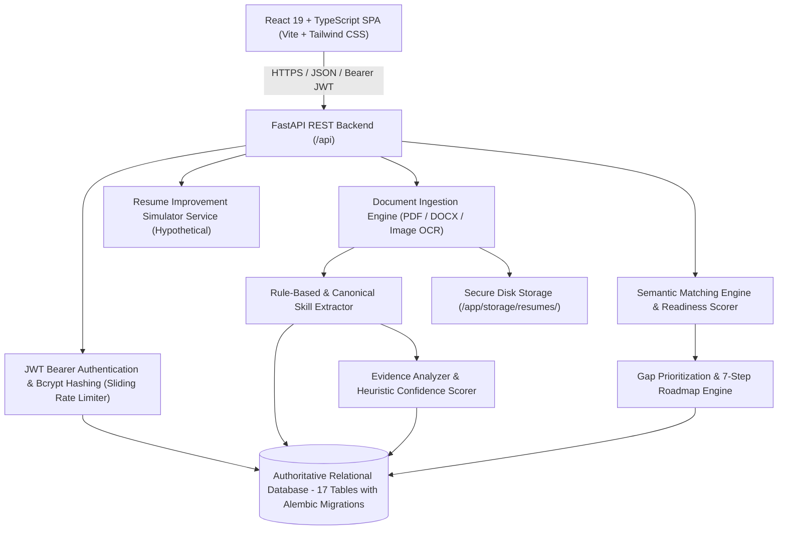

# Resume Skill Evidence Extraction & Gap Analysis Platform

[](LICENSE)
[](https://python.org)
[](https://fastapi.tiangolo.com)
[](https://react.dev)
[](https://www.typescriptlang.org)
[](https://sdgs.un.org/goals/goal8)

> **"We do not just identify whether a skill appears in a resume. We identify the supporting evidence, explain its strength, reveal prioritized skill gaps, and help candidates turn those gaps into practical, evidence-backed career growth."**

---

### ⚠️ Important Evaluation & Competence Disclaimer

> **PLEASE NOTE**: The scoring systems, evidence classifications, and resume simulations provided by this platform are **rule-based natural language text evidence heuristics** intended solely for diagnostic self-assessment and guided career upskilling.
>
> - **No Real-World Competence Verification**: This platform **does not verify** real-world candidate technical competence, genuine skill proficiency, or actual job performance.
> - **No Background or Credential Verification**: The platform does not verify the legal validity of employment history, educational degrees, or external certification credentials.
> - **No Code or Repository Authentication**: The platform does not inspect external GitHub commits or guarantee authorship of portfolio projects.
> - **No Hiring Suitability Guarantee**: Scores and readiness estimates should never be used as an automated hiring decision tool or substitute for human interviews.
> - **Hypothetical Simulations**: The Resume Improvement Simulator is explicitly hypothetical. Simulated improvements are unverified projections designed to help plan study goals, not claim unearned credentials.

---

## 1. Problem Statement

Traditional Applicant Tracking Systems (ATS) and resume screeners rely heavily on naive keyword matching. Candidates often receive match scores without understanding:
- Which claimed skills are genuinely supported by practical projects or work accomplishments.
- Which skills are merely mentioned in keyword lists.
- Why a particular skill matches or does not match a target job requirement.
- Which missing skills should be learned first according to job importance.
- How their job readiness can improve over time through measurable portfolio milestones.

The **Resume Skill Evidence Extraction & Gap Analysis Platform** solves this by moving beyond keyword matching. It extracts technical and soft skills, scans for sentence-level evidence, computes explainable confidence and proof scores, prioritizes gaps from Critical to Low, and offers a closed-loop 7-step upskilling roadmap.

---

## 2. SDG 8 Alignment: Decent Work and Economic Growth

**United Nations Sustainable Development Goal 8 (Target 8.6):**
> *"Substantially reduce the proportion of youth not in employment, education or training."*

College students and fresh graduates frequently struggle to bridge the gap between academic curricula and industry hiring expectations. This platform provides transparent, bias-free, evidence-backed career diagnostics, turning ambiguous rejections into structured project blueprints and measurable upskilling pathways.

---

## 3. Unique Project Differentiation

1. **Skill Claim vs. Skill Proof**: Distinguishes between a skill listed in a bullet points section versus one demonstrated in a practical project with action verbs and outcomes.
2. **Explainable Evidence Confidence Score (0–100)**: Transparent heuristic accounting for projects (40 pts), work experience (35 pts), certifications (20 pts), coursework (10 pts), action verbs (+15 pts), and measurable metrics (+15 pts).
3. **Skill Proof Score (0–100)**: Evaluates what proportion of a candidate's entire resume claims are backed by verifiable evidence.
4. **Explainable Job Readiness Score**: Uses transparent formula `(Sum of Weighted Requirement Points / Sum of Weights) * 100` with 2.0x weight for required skills and 1.0x for preferred skills.
5. **Prioritized Skill Gap Analysis**: Categorizes gaps into **Critical**, **High**, **Medium**, and **Low** with estimated completion efforts (e.g. 3–4 weeks).
6. **7-Step Gap-to-Growth Roadmap**: Structured milestone journey from foundations to GitHub README documentation, interactive Q&A assessment checks, and re-analysis.
7. **Resume Improvement Simulator**: Test hypothetical projects and certifications to see live score upgrades before editing genuine resume documents.
8. **Skill Evidence Knowledge Graph**: Interactive topological network connecting Candidate ➔ Skills ➔ Projects ➔ Target Role ➔ Gaps ➔ Upskilling.
9. **Historical Version Comparison**: Compare Report A vs Report B to inspect score deltas, newly acquired skills, strengthened evidence, and resolved gaps.
10. **Closed-Loop Improvement Workflow**:
    $$\text{Claim Skill} \longrightarrow \text{Find Evidence} \longrightarrow \text{Identify Gap} \longrightarrow \text{Learn} \longrightarrow \text{Pass Assessment} \longrightarrow \text{Add Evidence} \longrightarrow \text{Re-Analyze}$$

---

## 4. System Architecture



---

## 5. Technology Stack

### Frontend
- **Framework**: React 19 (`^19.3.1`) with TypeScript
- **Tooling**: Vite 8
- **Styling**: Tailwind CSS (Midnight Navy `#101B35`, Deep Navy `#182744`, Emerald `#10B981`, Warm Background `#F7F8FC`)
- **Icons**: Lucide React
- **Visualizations**: Recharts & Custom SVG Graph Visualization
- **Routing**: React Router DOM v7

### Backend
- **Framework**: Python 3.11+ / FastAPI (`0.110.0+`)
- **Validation**: Pydantic v2
- **ORM & Database**: SQLAlchemy 2.0 with Alembic database migrations
- **Security**: Bcrypt password hashing, sliding-window rate limiting, token revocation blacklist, strict password complexity
- **Document Parsers**: `pypdf` (with page limit enforcement), `python-docx`, `Pillow`
- **Testing**: Pytest & HTTPX

---

## 6. OCR Platform Support & Limitations

The platform supports parsing resumes from uploaded photos and scans (`PNG`, `JPG`, `JPEG`, `WEBP`, `BMP`):
- **Windows**: Uses Windows native Media OCR via PowerShell script `ocr_runner.ps1`.
- **Linux & Docker**: Uses `tesseract-ocr` via `pytesseract` (pre-installed in `backend/Dockerfile`). If neither is available, the upload endpoint returns a clear, handled error explaining the prerequisite rather than crashing.

---

## 7. Required Environment Configuration

Copy `.env.example` to `.env` before running:

| Variable | Required? | Default | Purpose |
|---|---|---|---|
| `ENVIRONMENT` | Yes | `development` | `development`, `staging`, or `production` |
| `SECRET_KEY` | **Required in Prod** | Dev fallback | 32+ character key for JWT signing. Server aborts on startup if missing in prod. |
| `DATABASE_URL` | No | `sqlite:///./data/platform.db` | Database connection string. |
| `CORS_ORIGINS` | No | `http://localhost:5173` | Comma-separated list of allowed frontend origins. |
| `DATA_DIR` | No | `./data` | Persistent database directory (mounted to `/app/data` in Docker). |
| `STORAGE_DIR` | No | `./storage/resumes` | Directory for uploaded resume files. |
| `SEED_DEMO_DATA` | No | `false` in prod (`true` in dev) | Only seed demo candidate accounts in development. |
| `SEED_ADMIN_EMAIL` | No | `""` | Administrator email to seed (leave blank in prod; use CLI/env). |
| `SEED_ADMIN_PASSWORD` | No | `""` | Administrator password to seed. |
| `MAX_FILE_SIZE_MB` | No | `15` | Maximum allowed file upload size. |
| `MAX_PDF_PAGES` | No | `15` | Maximum allowed PDF page count. |

---

## 8. Quick Start & Setup Instructions

### Prerequisites
- **Python**: Version 3.10 or higher (`python --version`)
- **Node.js**: Version 18 or higher (`node --version`)
- **npm**: Version 9 or higher (`npm --version`)

---

### Step 1: Backend Installation & Database Setup

```powershell
cd backend
pip install -r requirements.txt

# Run database migrations with Alembic
alembic upgrade head

# Initialize taxonomy and job roles
python -m app.database.init_db
```

---

### Step 2: Start the Backend Server

```powershell
python -m uvicorn app.main:app --host 127.0.0.1 --port 8000 --reload
```

Interactive API documentation: 👉 **`http://127.0.0.1:8000/docs`**

---

### Step 3: Frontend Installation & Launch

```powershell
cd frontend
npm install
npm run dev
```

Open your browser at: 👉 **`http://localhost:5173`**

---

## 9. Demo Credentials (Development Only)

In development environments (`ENVIRONMENT=development`), pre-configured demonstration accounts are available:

| Role | Email Address | Password | Features Available |
|---|---|---|---|
| **Demo Candidate** | `candidate@resumeskill.com` | `Candidate@2026!` | Preloaded student resume, evidence analysis, gap report, roadmap, simulator |
| **Administrator** | `skanishka5607@gmail.com` | `AdminSecret@2026!` | Platform-wide metrics, candidate management, user inspection, taxonomy management |

*Public registration always creates candidates with `role="candidate"`. Administrators can never be registered through the public registration interface.*

---

## 10. Running Automated Tests

Run the complete 25-test test suite verifying security, password validation, rate limiting, filename traversal, magic byte inspection, cross-user isolation, JD linguistic modal parsing, evidence scoring, roadmap generation, target job persistence, and collision-free graph topology:

```powershell
cd backend
python -m pytest app/tests/ -v
```

Expected output:
```
app/tests/test_api_endpoints.py::test_health_check_api PASSED            [  4%]
app/tests/test_api_endpoints.py::test_list_job_roles_public PASSED       [  8%]
app/tests/test_api_endpoints.py::test_auth_registration_and_login PASSED [ 12%]
app/tests/test_api_endpoints.py::test_user_isolation_security PASSED     [ 16%]
app/tests/test_platform.py::test_password_hashing PASSED                 [ 20%]
app/tests/test_platform.py::test_jwt_token_flow PASSED                   [ 24%]
app/tests/test_platform.py::test_skill_extraction_and_alias_normalization PASSED [ 28%]
app/tests/test_platform.py::test_evidence_analyzer_scoring PASSED        [ 32%]
app/tests/test_platform.py::test_claimed_skill_classification PASSED     [ 36%]
app/tests/test_platform.py::test_matching_engine_and_readiness_score PASSED [ 40%]
app/tests/test_platform.py::test_skill_proof_score PASSED                [ 44%]
app/tests/test_platform.py::test_gap_prioritization PASSED               [ 48%]
app/tests/test_production_security.py::test_public_registration_cannot_escalate_to_admin PASSED [ 52%]
app/tests/test_production_security.py::test_password_strength_enforcement PASSED [ 56%]
app/tests/test_production_security.py::test_token_revocation_on_logout PASSED [ 60%]
app/tests/test_production_security.py::test_filename_sanitization_and_uuid_storage PASSED [ 64%]
app/tests/test_production_security.py::test_magic_bytes_validation PASSED [ 68%]
app/tests/test_production_security.py::test_cross_user_isolation_and_gap_item_tampering PASSED [ 72%]
app/tests/test_production_security.py::test_job_description_parsing_without_half_split PASSED [ 76%]
app/tests/test_production_security.py::test_dynamic_roadmap_values_from_gap_item PASSED [ 80%]
app/tests/test_target_job_and_graph.py::test_latest_gap_report_target_persistence PASSED [ 84%]
app/tests/test_target_job_and_graph.py::test_custom_job_description_persistence_and_title PASSED [ 88%]
app/tests/test_target_job_and_graph.py::test_cross_user_isolation_on_latest_gap_report PASSED [ 92%]
app/tests/test_target_job_and_graph.py::test_graph_endpoint_with_specific_gap_report_id PASSED [ 96%]
app/tests/test_target_job_and_graph.py::test_graph_layout_collision_free PASSED [100%]

======================= 25 passed in 6.54s =======================
```

---

## 11. Docker Deployment

Deploy with Docker Compose using persistent data volumes:

```bash
docker-compose up --build
```

- Data is persisted across container restarts in the `backend-data` volume mapped to `/app/data`.
- Uploaded resumes are stored in `./storage/resumes`.

---

## 12. License

This project is licensed under the [MIT License](LICENSE).
