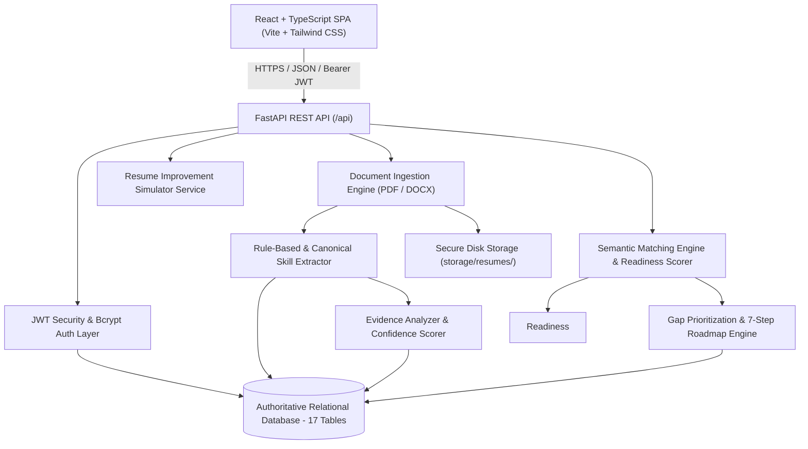

# Architecture Overview

## Resume Skill Evidence Extraction & Gap Analysis Platform

### 1. High-Level System Architecture

The platform follows a decoupled, layered micro-architecture featuring a React + TypeScript frontend, a high-performance Python FastAPI backend, an authoritative relational database (SQLite for local development, PostgreSQL ready), and an explainable AI/NLP pipeline.

---

### 2. Layered NLP Pipeline

The AI/NLP engine operates in three distinct, explainable layers:

1. **Layer 1: Rule-Based Extraction & Canonical Normalization**
   - Ingestion of PDF (via `pypdf`) and DOCX (via `python-docx`).
   - Section segmentation with regularized heading patterns (Education, Skills, Projects, Experience, Certifications, Coursework).
   - Multi-word first regex matching with word-boundary (`\b`) protection against substring false-positives (e.g. "Java" inside "JavaScript", "C" in "CSS").
   - Alias normalization mapping non-standard naming to canonical taxonomy entities (e.g. `JS` ➔ `JavaScript`, `postgre sql` ➔ `PostgreSQL`, `k8s` ➔ `Kubernetes`).

2. **Layer 2: Skill Evidence & Context Extraction**
   - Sentence-level extraction tying each extracted skill to its source sentence.
   - Evidence classification:
     - **Evidence-Backed Skill**: Supported by practical project implementation, quantifiable outcomes, or work experience.
     - **Weakly Supported Skill**: Studied in coursework or mentioned briefly without implementation depth.
     - **Claimed Skill**: Appears only in keyword list items.
     - **Verified Skill**: Reserved for externally verified credentials.
   - Confidence scoring (0–100) using configurable design weights (Projects: 40, Work Exp: 35, Certs: 20, Coursework: 10, List: 5) plus action verb (+15) and metrics (+15) multipliers.

3. **Layer 3: Explainable Job Matching & Closed-Loop Upskilling**
   - Target job requirement parsing (Required vs Preferred).
   - Weighted job readiness scoring: `(Sum of Weighted Requirement Points / Sum of Weights) * 100`.
   - Skill Proof Score: `(Sum of Evidence Contributions / Total Claimed Skills) * 100`.
   - 7-Step Roadmap generation and hypothetical resume improvement simulator.
