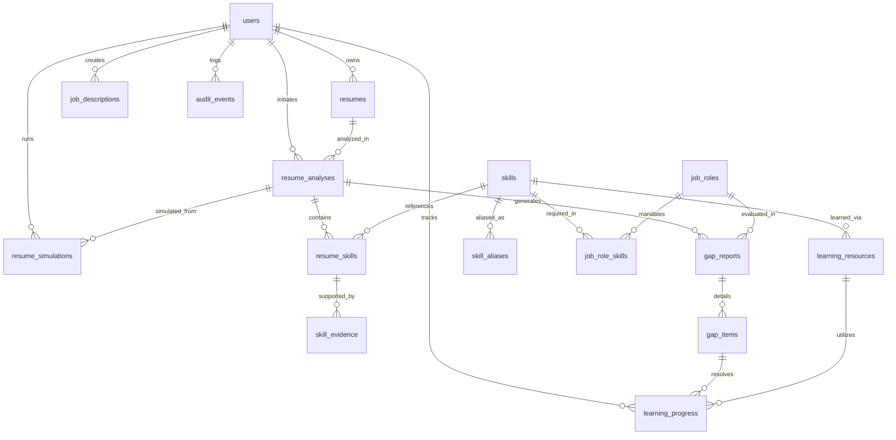

# Database Schema Design

The authoritative database schema consists of 17 relational tables with foreign keys, cascade deletes, indices, and audit logging.

### Table Specifications

1. **`users`**: User identities, roles (`candidate`, `admin`), hashed passwords.
2. **`resumes`**: Uploaded resume documents, storage keys, extracted raw text, file types (`pdf`, `docx`), processing status.
3. **`resume_analyses`**: Immutable snapshot of parsed sections, candidate profile, and analysis versions.
4. **`skills`**: Master taxonomy containing canonical names, categories, and descriptions.
5. **`skill_aliases`**: Alternative spellings, abbreviations, and informal names normalized to canonical skills.
6. **`resume_skills`**: Skills matched in a resume analysis, source section, evidence classification, and confidence score.
7. **`skill_evidence`**: Sentence excerpts from resume text providing tangible proof, source section, and explainability notes.
8. **`job_roles`**: Predefined and custom career target roles.
9. **`job_role_skills`**: Skills required or preferred for a job role, with importance weights and minimum proficiencies.
10. **`job_descriptions`**: Pasted custom job descriptions and their dynamically extracted requirements.
11. **`gap_reports`**: Evaluation reports containing Job Readiness Score, Skill Proof Score, and timestamp.
12. **`gap_items`**: Individual requirement status (`Strong Match`, `Partial Match`, `Claimed Match`, `Missing Skill`), priority, and action.
13. **`learning_resources`**: Curated courses, documentation, and labs linked to skills.
14. **`learning_progress`**: Candidate learning tasks, status (`Not Started`, `In Progress`, `Completed`), and notes.
15. **`resume_simulations`**: Hypothetical project and certification scenarios tested by candidates.
16. **`projects`**: Candidate portfolio projects.
17. **`audit_events`**: Audit log recording logins, uploads, analyses, and system events.
